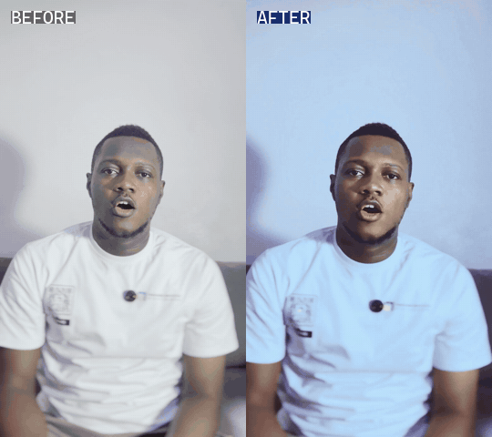

# 🎬 Reel Director

**One command turns a raw talking-head clip into a finished, on-brand short video.**
A [Claude Code](https://claude.com/claude-code) skill by **Prof Tidjani**.

```
/reel-director C:\Videos\IMG_1234.MOV
```

<!-- demo: replace with your before/after GIF -->
<p align="center"></p>

## What it does
| | |
|---|---|
| ✂️ **Cut** | Removes pauses, retakes, false starts and filler words (any language), with punch-in zooms to hide jump cuts |
| 🎨 **Grade** | Matches *your* look: a reference video/link, your CapCut/VN/Lightroom preset (from one before/after still), your Premiere/Resolve `.cube` LUT, or a built-in look. Skin tones stay natural on every skin colour |
| 🔤 **Captions** | Word-synced animated captions in your brand colours (3 styles) |
| 📊 **Graphics** | Full-screen stat pages (counters, donuts, bars, lists, comparisons, sources), kinetic titles above your head, UI mockups (prompt bar, app delete, timeline, eyedropper), b-roll, quotes, comment CTAs - never over your face |
| 🔁 **Endings** | Seamless loops, follow cards, comment-keyword CTAs, link cards |
| 🎵 **Sound** | Voice cleanup, royalty-free music composed to fit (or your own track), synced sound effects, -14 LUFS |
| 📱 **Formats** | 9:16, 16:9, 1:1, 4:5 - rendered straight at social-media size |

The first time, it interviews you (brand colours, fonts, references, style, platforms) and saves a
**profile**. Every video after that is one command plus a couple of quick choices.

## Install
1. **Requirements** (the doctor checks them all):
   - [Python 3.10+](https://python.org) with `pip install numpy pillow faster-whisper`
   - [FFmpeg](https://ffmpeg.org) (full build), [Node.js 18+](https://nodejs.org)
   - [HyperFrames](https://hyperframes.heygen.com) renderer - runs via `npx hyperframes` (no install step)
2. **Get the skill**:
   ```bash
   git clone https://github.com/Ayinla10/reel-director.git
   ```
   Copy `skills/reel-director` into your Claude skills folder:
   - macOS/Linux: `~/.claude/skills/reel-director`
   - Windows: `%USERPROFILE%\.claude\skills\reel-director`
3. **Check**: `python ~/.claude/skills/reel-director/scripts/doctor.py`
4. In Claude Code: `/reel-director path/to/video.mov`

## Bring your own look
| You use… | Give the skill… |
|---|---|
| A creator/video you love | the link or file - it screenshots and matches it |
| Premiere Pro, DaVinci Resolve, Final Cut, Photoshop | an exported **.cube** LUT |
| CapCut, VN, InShot, Lightroom mobile, Snapseed, VSCO | the **same frame exported twice**: without and with your preset - it learns the preset (≈2/255 error on unseen frames) |
| Nothing yet | pick a look: bright-clean, bright-blue, natural, warm-film, golden-hour, soft-pastel, moody, mono |

## Starter profiles
`assets/profiles/` - **Bright Navy** (bright bluish educator), **Warm Film** (cinematic), **Bold Creator**
(high-energy black + yellow). Use one as-is or as a starting point in the interview.

## How it works
```
prepare.py  → transcript (Whisper, any language), pauses, retake hints, face position
grade.py    → per-video 3D LUT: auto exposure + white balance, brand tint, skin protection,
              closed-loop matching to your reference / preset / LUT
cut.py      → cut + frame + punch-ins + grade + skin finish in ONE decode pass, cleaned voice
build.py    → brand-driven HyperFrames composition from Claude's effect plan (beats.json)
audio.py    → composed music (loops exactly when needed), synthesized SFX, ducked mix
render.py   → preview frames for one approval, then a single render at social bitrate
```
Claude reads the transcript and makes the editorial calls (what to cut, which moment gets which
graphic); the scripts do the deterministic heavy lifting.

## Tips
- Rendering is CPU-heavy. On a laptop expect roughly 10-25 min for a 90 s 4K phone clip.
- Close browsers while rendering if you have 8 GB of RAM.
- Everything stays local; music and sound effects are generated, so there are no licensing issues.
  Fonts are open-licensed (OFL) and installed from npm (@fontsource).

## License
MIT © Prof Tidjani. Uses [HyperFrames](https://hyperframes.heygen.com), [GSAP](https://gsap.com) (installed
from npm under its own license), [faster-whisper](https://github.com/SYSTRAN/faster-whisper) and FFmpeg.
